  

  

  

  

---

<table>
  <tr>
    <td width="58%" valign="top">

<h3 align="center">👨‍💻 About Me</h3>

Software Engineering undergraduate at Anhanguera and Systems Development Technician graduated from SENAI CTTI MG. I build practical software projects with a focus on backend, APIs, databases, local AI, IoT and software-hardware integration.

<ul>
  <li><strong>Education:</strong> Software Engineering — Anhanguera (in progress).</li>
  <li><strong>Technical background:</strong> Systems Development — SENAI CTTI MG.</li>
  <li><strong>Focus:</strong> backend development, APIs, databases and systems integration.</li>
  <li><strong>Interests:</strong> local AI, automation, IoT, embedded systems and software architecture.</li>
</ul>

</td>

<td width="42%" valign="top">

<h3 align="center">📊 GitHub Statistics</h3>

  

</td>
  </tr>
</table>

## 🧰 Core Stack & Technical Interests

**Main focus:** backend engineering, APIs, databases and software integration. **Hands-on exploration:** local AI, embedded systems, web interfaces and game development.

  

---

## 🚀 Selected Projects

**Zypher** is my personal portfolio and visual identity for software, AI and hardware experiments—not a registered company or a claim that every concept is complete.

### Public code

**[Zypher](https://github.com/PHenriquen/Zypher)** — Next.js/TypeScript portfolio and visual identity.  
**[Manopla Inteligente](https://github.com/PHenriquen/Manopla-Inteligente)** — ESP32 firmware, serial telemetry protocol, OpenSCAD mechanics and interactive 3D engineering lab. Physical assembly is still in progress.

### Current work · private repositories

These are active or developing projects. Their source code is currently private, so external visitors may not be able to inspect the repositories.

- **SYGNAL** — local-first project traceability: GitHub webhooks, task links and synchronization history. SaaS and native mobile client are future goals.
- **ILLUME** — Windows desktop assistant with local models, voice experiments and permission-controlled actions.
- **S.V.I. 4.0** — industrial monitoring prototype connecting ESP32, FastAPI, telemetry and a web dashboard.
- **Elume Achados** — product-curation website; a simple authenticated catalog manager is the next major feature.
- **Ressonância Zero** — original 2D action game in pre-production, centered on waves, rhythm, builds and two characters.

### Planned experiments

**WARDEN** (local file-integrity prototype), **ApexOS** (distributed infrastructure), **OmniData** (data science) and physical prototypes **VYSION**, **Garra Arc** and **Mark I** remain experimental; VYSION has a simulated telemetry interface and WARDEN has browser-local SHA-256 verification. These are not completed devices or a full security platform.

---

<h3 align="center">🌐 Explore My Work</h3>

  More details, project context and my current résumé are available in my portfolio.

  

